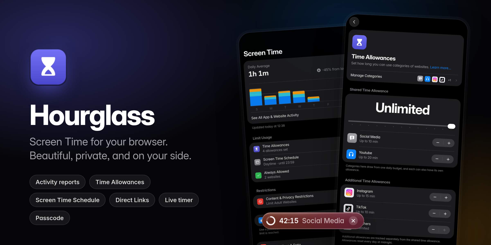
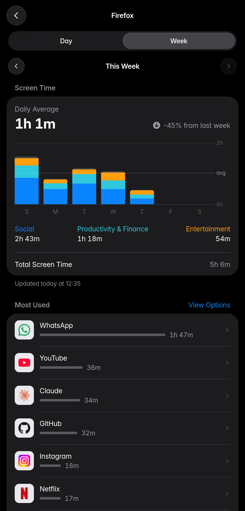
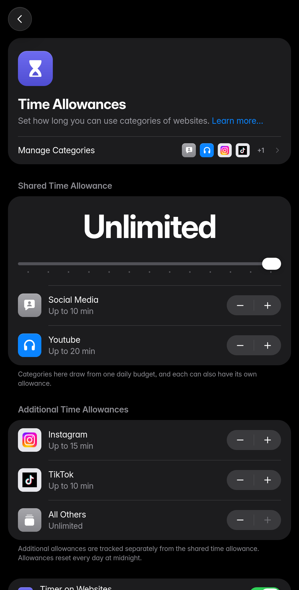
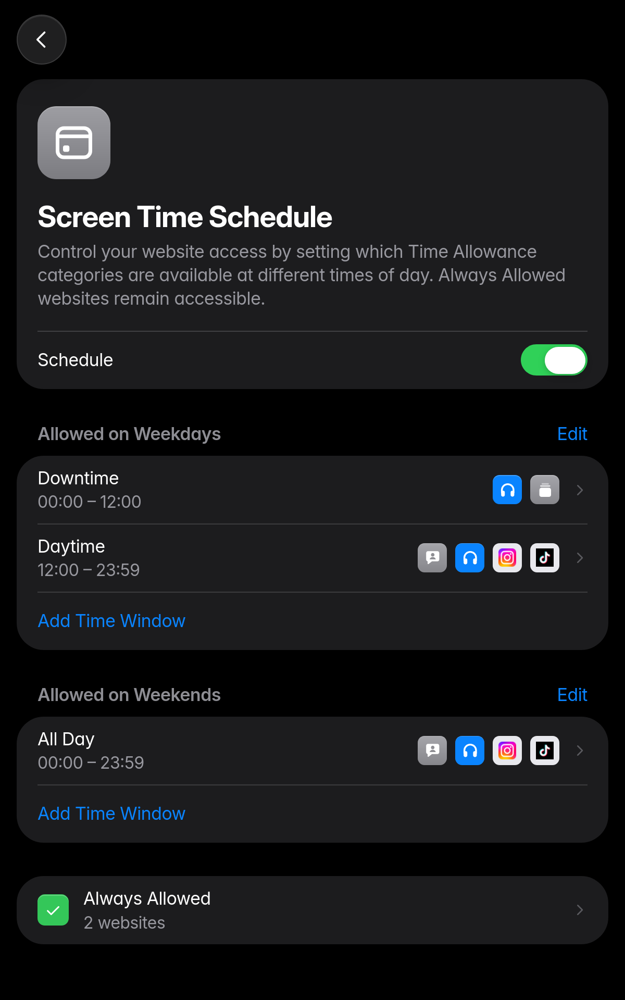
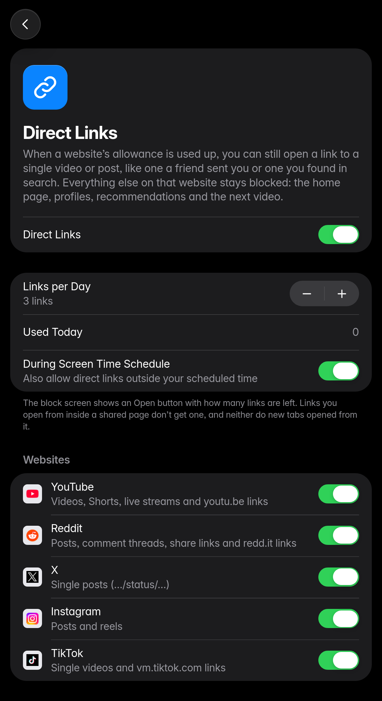
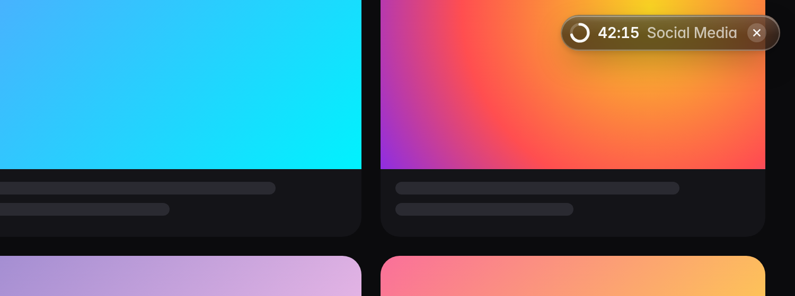
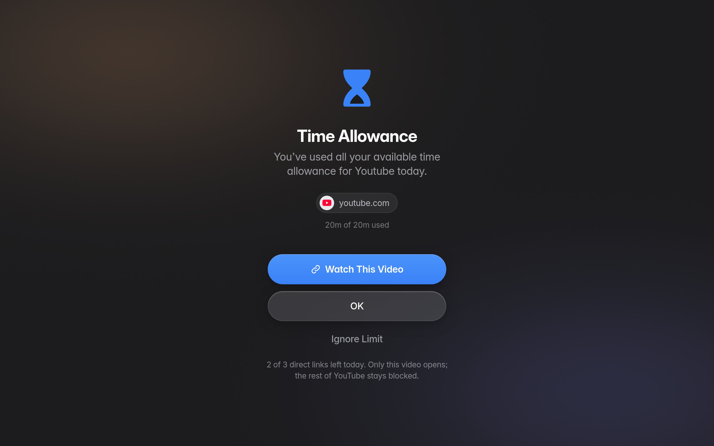
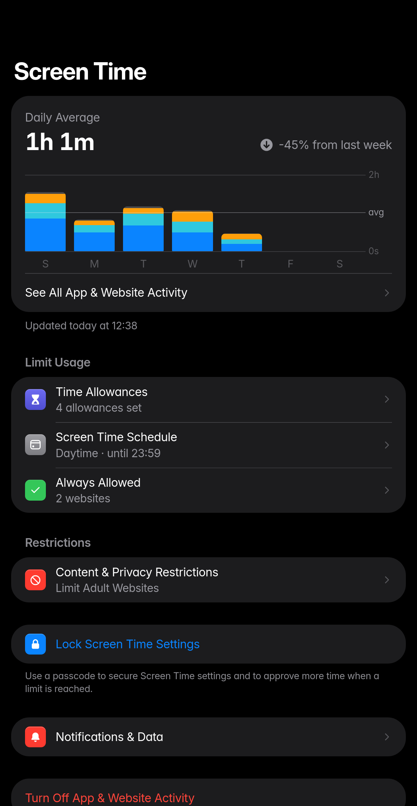
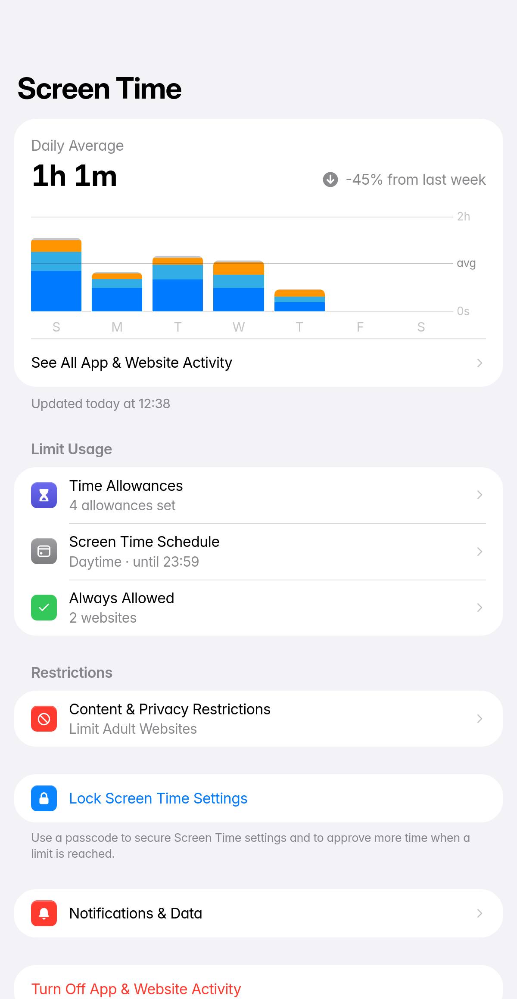
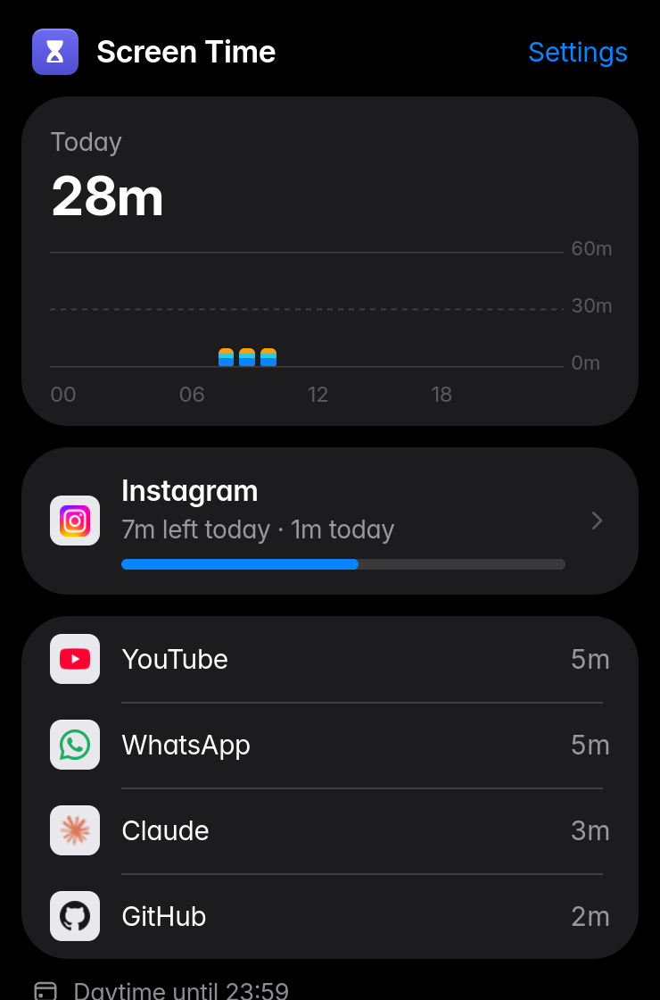

<p align="center">
  
</p>

<h1 align="center">Hourglass</h1>

<p align="center">
  <strong>Screen Time for your browser.</strong><br>
  The time-management tools you know from your phone, rebuilt for the place you actually lose the afternoon.
</p>

<p align="center">
  <a href="https://github.com/chopin014/hourglass-screen-time/actions/workflows/ci.yml"></a>
  <a href="https://github.com/chopin014/hourglass-screen-time/releases/latest"></a>
  
  
  <a href="LICENSE"></a>
</p>

---

Hourglass shows you where your browsing time goes and helps you set limits you'll actually keep. It runs entirely on your computer, with no accounts, no servers and no analytics. Everything is designed to feel at home next to the Screen Time on your phone, from the charts to the block screen.

## Highlights

<table>
  <tr>
    <td width="50%" valign="top">
      
      <h3>Activity reports</h3>
      Day and week views with a daily average, the change from last week, and a stacked chart of your top categories. Also: your most used websites, pickups, first site used after each pickup, and notification counts per site. Open any website or category for its own history.
    </td>
    <td width="50%" valign="top">
      
      <h3>Time Allowances</h3>
      Give categories one <em>shared</em> daily budget, give each one its own limit, or both. Use the built-in categories (Social Media, Entertainment, Games…), single websites, or custom groups with your own icon and color. <em>All Others</em> covers everything else.
    </td>
  </tr>
  <tr>
    <td width="50%" valign="top">
      
      <h3>Screen Time Schedule</h3>
      Split the day into time windows, like <em>Downtime</em> in the morning and <em>Daytime</em> after noon, and choose which categories each one allows. Set different schedules for weekdays and weekends. You get a heads-up five minutes before a window closes.
    </td>
    <td width="50%" valign="top">
      
      <h3>Direct Links</h3>
      Out of YouTube time, but a friend just sent you one video? Open <em>that</em> video, and only that video. The home page, recommendations, autoplay, channels and profiles stay blocked. Works with YouTube, Reddit, X, Instagram and TikTok, with a daily limit you choose.
    </td>
  </tr>
</table>

### A timer that's there when you need it

<p align="center"></p>

Every website with a limit gets a small glass timer with a live countdown and a progress ring. It turns orange at five minutes left and red in the last minute. It only counts while you're actually on the page, hover shows which allowance it belongs to, and you can drag it to any corner. In fullscreen video it stays hidden until the last five minutes.

### A block screen that respects you

<p align="center"></p>

When time is up, the site is replaced by a calm block screen instead of an error page. **Ignore Limit** works the way you'd expect: *One More Minute*, *Remind Me in 15 Minutes* or *Ignore Limit for Today*. With a Screen Time passcode it asks for the code, then *Approve for 15 Minutes*, *for an Hour* or *All Day*.

### Everything else

| | |
|---|---|
| **Always Allowed** | Websites that stay available during your schedule and never count toward your allowances. |
| **Content & Privacy Restrictions** | Limit adult websites, with your own *Always Allow* and *Never Allow* lists, or allow only websites you approve. |
| **Screen Time Passcode** | A 4-digit passcode that locks your settings and is needed to approve more time. |
| **Notifications** | *Time Check* alerts at 5 and 1 minute left, schedule reminders, and a weekly report every Monday. |
| **Toolbar widget** | Today's screen time, time left on the current site, and your top websites at a glance. |
| **Light & dark** | Follows your system appearance throughout. |

<p align="center">
  
  
  
</p>

## Install

Hourglass works in Firefox and Firefox-based browsers (Zen, LibreWolf, Floorp, Waterfox) version 128 or later. A Chromium version is planned.

**Try it in Firefox**

1. Download or clone this repository.
2. Open `about:debugging#/runtime/this-firefox` and choose **Load Temporary Add-on…**
3. Select `manifest.json`.

Temporary add-ons are removed when the browser restarts.

**Install permanently (Zen, LibreWolf, Firefox Developer Edition / Nightly)**

1. Download `hourglass-x.y.z.xpi` from the [latest release](https://github.com/chopin014/hourglass-screen-time/releases/latest).
2. In `about:config`, set `xpinstall.signatures.required` to `false`.
3. Drag the `.xpi` file into a browser window and confirm.

Firefox Release and Beta only install add-ons signed by Mozilla. On those, use the temporary install above until Hourglass is published on addons.mozilla.org.

> **Tip:** Hourglass doesn't track private windows by default. To include them, open `about:addons` → Hourglass and turn on **Run in Private Windows**.

## Privacy

Hourglass is built to be trusted with the most personal data a browser has.

- **On-device only.** Usage, settings and history live in the extension's local storage. Nothing is sent anywhere, and there are no analytics, telemetry or remote config.
- **Minimal data.** It records time per website hostname, per hour, never full URLs or page content. History older than 180 days is deleted automatically.
- **Yours to take or delete.** Export, import or clear everything from **Notifications & Data**.
- **Network:** the only requests it makes are for website icons, loaded from the sites you've already visited.

**Permissions**

| Permission | Why |
|---|---|
| `tabs`, `webNavigation` | See which website is active and block one when its time is up. |
| `idle` | Stop counting when you step away. |
| `storage`, `unlimitedStorage` | Keep your usage history on your device. |
| `alarms`, `notifications` | Time Check alerts, schedule reminders and the weekly report. |
| Access to all websites | Show the on-page timer and count website notifications. |

## How it works

- **Counting.** A Manifest V3 background script counts time for the active tab in the focused window. It pauses when you're idle for a minute, unless the tab is playing audio. The current session is kept in `storage.session`, so counting survives the background script being suspended, and exact alarms fire right at each limit or schedule boundary.
- **Rules.** One rules engine, `src/lib/policy.js`, decides whether a website is available and how much time it has left. The background script and every page share it.
- **Blocking.** A blocked tab is replaced with the block screen before the site loads. In-page navigation counts too (YouTube and Reddit change pages without reloading), so Direct Links can't be used to browse the rest of a site.
- **UI.** Plain HTML, CSS and ES modules, with no framework and no build step. The interface uses the bundled Inter font so it looks the same on every operating system.

## Development

```bash
npm install        # installs web-ext
npm test           # rules engine, tracker and Direct Links tests (node:test)
npm run lint       # Mozilla's add-on linter
npm start          # launches Firefox with the extension loaded
npm run build      # packages web-ext-artifacts/hourglass-<version>.xpi
```

```
src/
├── background.js        tracking, enforcement, notifications
├── content/             on-page timer, notification counter
├── lib/                 rules engine, categories, reports, UI kit
└── pages/               dashboard, toolbar popup, block screen
test/                    Node tests with a mocked WebExtension API
```

Contributions are welcome. Please run `npm test` and `npm run lint` before opening a pull request.

## Roadmap

- Chromium version (Chrome, Edge, Brave, Arc)
- Listing on addons.mozilla.org
- Optional sync of settings between devices
- More Direct Links sites

## Acknowledgements

Inspired by Screen Time on iPhone. Hourglass is an independent project and is not affiliated with, endorsed by or sponsored by Apple Inc. Apple, iPhone, iOS and Screen Time are trademarks of Apple Inc.

Interface type is [Inter](https://rsms.me/inter/) by Rasmus Andersson, used under the SIL Open Font License 1.1 (see `src/fonts/LICENSE-Inter.txt`).

## License

[MIT](LICENSE) © chopin014
